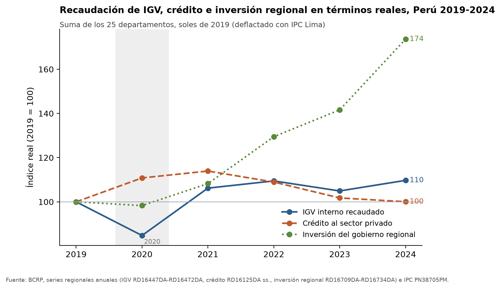
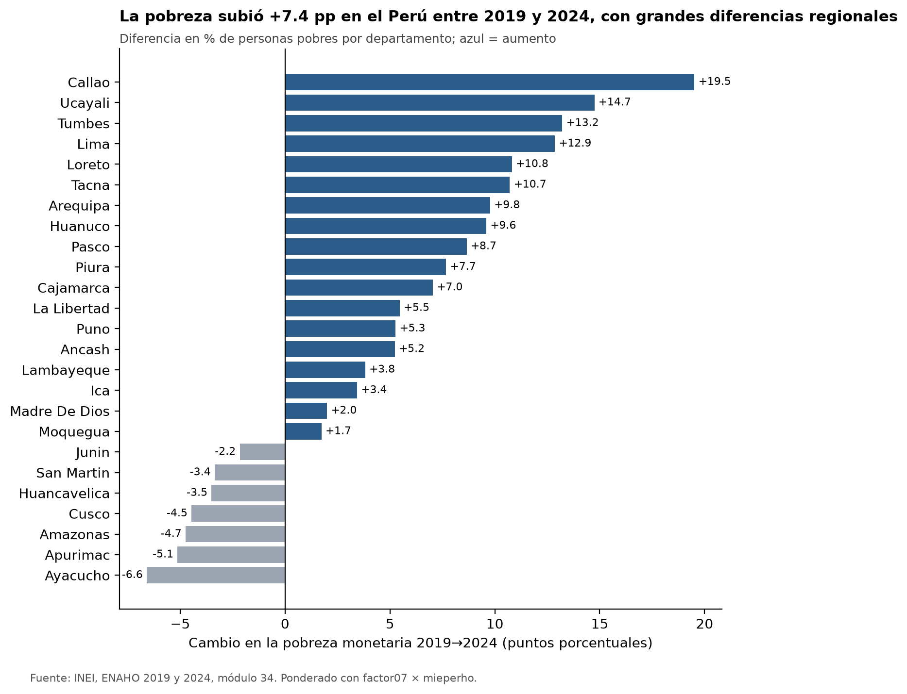
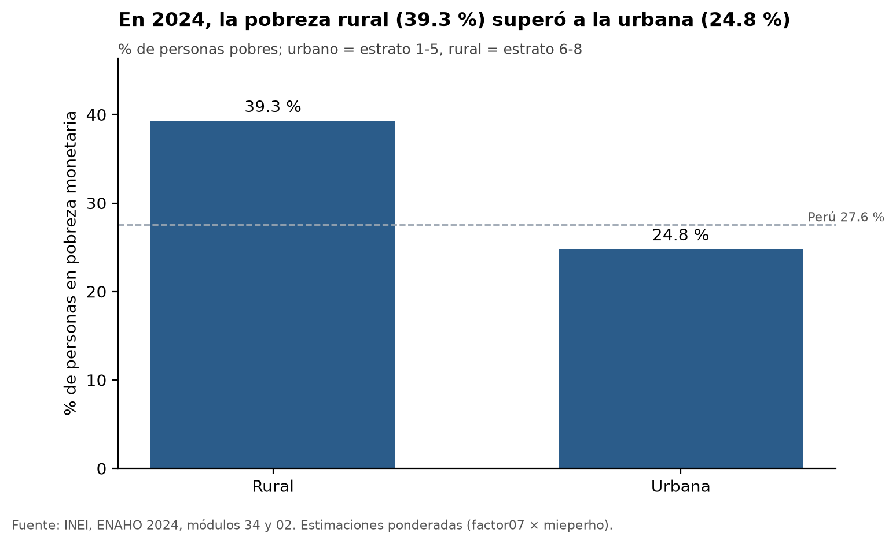
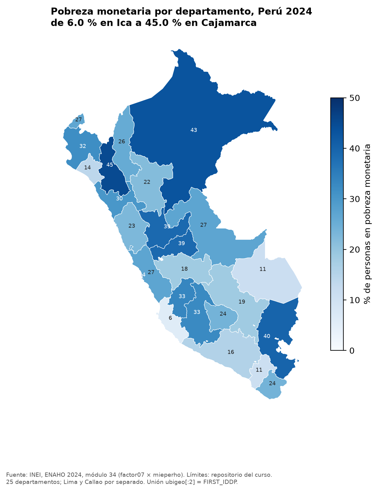

# Pobreza prepandemia y recuperación económica departamental en el Perú, 2019-2024

## 1. Pregunta de investigación

- **Tema:** relación entre la pobreza monetaria departamental y la recuperación económica después de la pandemia.
- **Pregunta:** ¿Los departamentos con mayor pobreza monetaria antes de la pandemia (2019) tuvieron una recuperación económica más débil entre 2019 y 2024? ¿Cómo se distribuía la pobreza departamental en 2024?
- **Objetivo:** describir asociaciones (no efectos causales) entre la pobreza de 2019 (ENAHO) y tres indicadores reales de actividad departamental del BCRP, y presentar el mapa de la pobreza de 2024.
- **Delimitación:** 25 departamentos (Lima y Callao por separado en la ENAHO; Lima Metropolitana y Lima Provincias suman el ccdd 15 en el BCRP); años 2019 y 2024; pobreza monetaria oficial del INEI.

## 2. Fuentes y metodología

| Fuente | Contenido | Herramienta |
|---|---|---|
| BCRP, `PM04923AA` | PBI, variación % real anual | MCP `bcrp`: `buscar_series`, `serie`, `resumen` |
| BCRP, `PN01273PM` | IPC Lima Metropolitana, var. % 12 meses | MCP `resumen`, `comparar_periodos` |
| BCRP, `RD16447DA`–`RD16472DA` | IGV interno por departamento | MCP `panel_departamental` → `salidas/bcrp_igv_2019_2024_real.csv` |
| BCRP, `RD16127DA`–`RD16199DA` | Crédito directo al sector privado por departamento | → `salidas/bcrp_credito_2019_2024_real.csv` |
| BCRP, `RD16709DA`–`RD16734DA` | Inversión bruta fija de gobiernos regionales | → `salidas/bcrp_inversion_regional_2019_2024_real.csv` |
| INEI, ENAHO 2019 (687) y 2024 (966), módulos 34 y 02 | Pobreza monetaria | Skill `limpiando-enaho` |

Los paneles BCRP se deflactaron a soles de 2019 con el promedio anual del IPC de Lima (`PN38705PM`). El índice de recuperación es valor 2024 / valor 2019 × 100 (100 = mismo nivel real). La pobreza se estimó con la sumaria ponderada por `factor07 × mieperho` (método INEI). El cruce (skill `cruzando-bcrp-enaho`) une por `ccdd`, calcula correlaciones de Spearman (n = 25) y compara medianas por terciles de pobreza 2019.

**Validación:** la limpieza aprobó todas las validaciones (`salidas/validacion_2019.txt`, `salidas/validacion_2024.txt`): pobreza nacional 20.19 % en 2019 (ref. 20.2 %) y 27.58 % en 2024 (ref. 27.6 %). El mapa coincide en 25/25 departamentos con la referencia de la Sesión 16 (diferencia máxima 0.00 pp, `salidas/comparacion_mapa_2024.txt`).

**Fallos de herramientas:** ninguna herramienta falló. Solo la búsqueda `buscar_series("ipc lima", frecuencia="Anual")` no devolvió resultados; se usó la serie mensual `PN01273PM`.

## 3. Hallazgos

**H1. Contexto macro: caída y rebote del PBI con una inflación por encima de la de antes de la pandemia.** El PBI real (`PM04923AA`, 2019-2024) creció 2.24 % en 2019, cayó −10.93 % en 2020 (mínimo), rebotó 13.42 % en 2021 (máximo), creció 2.82 % en 2022, −0.35 % en 2023 y 3.52 % en 2024; la variación anual media en el periodo fue 1.78 %. La inflación de Lima a 12 meses (`PN01273PM`) llegó a un máximo de 8.81 % en 2022-06 y cerró en 1.97 % en 2024-12. Con `comparar_periodos`, su promedio pasó de 2.09 % (2017-01 a 2019-12) a 5.51 % (2022-01 a 2024-12), +3.42 pp. Por eso los paneles departamentales se trabajaron en términos reales.

**H2. Los departamentos más pobres en 2019 no tuvieron una recuperación sistemáticamente más débil; con el crédito, la asociación va en sentido contrario.** Fuente: `salidas/cruce_resumen.txt` y `salidas/cruce_departamental.csv`, con índices reales 2024/2019.
- IGV (`RD16447DA`–`RD16472DA`): rho de Spearman = −0.01, sin asociación.
- Crédito (`RD16127DA`–`RD16199DA`): rho = +0.51. Es la única que supera el valor crítico aproximado de 0.40 (n = 25, 5 %). Los departamentos más pobres en 2019 tendieron a tener más crecimiento real del crédito. Medianas del índice por tercil: menos pobre 97.9, medio 104.2, más pobre 108.2.
- Inversión regional (`RD16709DA`–`RD16734DA`): rho = +0.21, no distinguible de cero.

En medianas del IGV real, el tercil más pobre (103.8) quedó por debajo del medio (115.6) y del menos pobre (110.7). Es un indicio débil, porque la correlación es nula.

**H3. La pobreza subió más en los departamentos menos pobres en 2019, y algunos de los más pobres la redujeron.** Fuente: `salidas/pobreza_departamento_2019_2024.csv`. La correlación entre la pobreza de 2019 y su cambio en pp es −0.29, no significativa (`salidas/cruce_resumen.txt`). La mediana del cambio fue +9.8 pp en el tercil menos pobre y +6.2 pp en el más pobre. Los mayores aumentos fueron Callao (14.3 % → 33.9 %, +19.5 pp), Ucayali (+14.7 pp), Tumbes (+13.2 pp) y Lima (14.2 % → 27.1 %, +12.9 pp). Las mayores reducciones fueron Ayacucho (39.4 % → 32.8 %, −6.6 pp), Apurímac (−5.1 pp) y Amazonas (−4.7 pp).

**H4. Distribución en 2024: la pobreza se concentra en la sierra norte, la selva y el área rural.** Fuentes: `salidas/indicadores_2024.csv` y `salidas/comparacion_mapa_2024.txt`. Los valores más altos son Cajamarca 45.0 %, Loreto 43.0 % y Puno 39.9 %; luego Huánuco y Pasco con 39.0 %. Los más bajos son Ica 6.0 %, Moquegua 11.0 % y Madre de Dios 11.1 %. La pobreza rural (39.3 %) supera a la urbana (24.8 %), con un total nacional de 27.58 %.

## 4. Visualizaciones

*Figura 1. Evolución real 2019-2024 (2019 = 100) del IGV interno, el crédito al sector privado y la inversión regional, suma de los 25 departamentos. Fuente: BCRP; deflactor IPC Lima `PN38705PM`. (Los índices por departamento están en la figura complementaria.)*

*Figura 2. Cambio de la pobreza monetaria por departamento, 2019-2024 (pp). Fuente: INEI, ENAHO.*

*Figura 3. Pobreza urbana y rural, 2024. Fuente: INEI, ENAHO 2024.*

*Figura 4. Pobreza monetaria por departamento, 2024 (% de personas). Fuente: INEI, ENAHO 2024.*

Figura complementaria: `figuras/cruce_pobreza2019_recuperacion.png`.

## 5. Interpretación

No se encontró evidencia de que los departamentos más pobres antes de la pandemia tuvieran una recuperación económica más débil luego de la pandemia. 

Por el contrario, el aumento de la pobreza entre 2019 y 2024 fue mayor en departamentos que en 2019 eran menos pobres y más urbanos, como Callao, Lima, Tumbes y Ucayali. Esto es compatible con la mayor subida de la pobreza urbana. 

Sin embargo, en 2024 los niveles más altos de pobreza siguen en departamentos que ya eran pobres en 2019, como Cajamarca, Loreto y Puno. Es decir, si bien no hubo una recuperación económica más lenta de los departamentos pobres, estos departamentos no lograron sobreponerse a su concentración de pobreza al 2024. 

Estas interpretaciones solo apuntan a relaciones limitadas a las regiones. Esto no apunta a relaciones causales.

## 6. Limitaciones

- n = 25: poca potencia estadística. Solo |rho| ≥ 0.40 es distinguible de cero al 5 %.
- Los índices BCRP son nominales deflactados con el IPC de Lima. Los precios regionales pueden haber variado de otra forma.
- El IGV refleja dónde se recauda (domicilio fiscal), no solo dónde se consume. Esto sobrerrepresenta a Lima.
- El crédito es un saldo a fin de año y la inversión regional es muy volátil entre años: los índices de 2024 frente a 2019 dependen mucho de los años extremos.
- La pobreza departamental de la ENAHO tiene error muestral (por ejemplo, n muestral = 913 en Apurímac en 2024, según `salidas/comparacion_mapa_2024.txt`). Las diferencias pequeñas entre departamentos no son concluyentes.
- No se usó el PBI departamental. Los tres indicadores son aproximaciones parciales de la actividad.

## 7. Reproducibilidad

Desde `tarea_4/`:

1. Servidor MCP `bcrp` (`mcp/server.py`):
   - `resumen("PM04923AA","2019","2024")`
   - `resumen("PN01273PM","2019-01","2024-12")`
   - `comparar_periodos("PN01273PM","2017-01","2019-12","2022-01","2024-12")`
   - `panel_departamental(indicador)` para `igv`, `credito` e `inversion_regional` (2019-2024, real=True)
2. `uv run .claude/skills/limpiando-enaho/scripts/limpiar.py --anio 2019`, y lo mismo con `--anio 2024`. Requiere `datos/687-Modulo34.zip`, `datos/687-Modulo02.zip`, `datos/966-Modulo34.zip` y `datos/966-Modulo02.zip`.
3. `uv run .claude/skills/graficando-enaho/scripts/graficar.py --tipo area --anio 2024`, y luego `--tipo cambio --anio 2024`.
4. `uv run .claude/skills/mapeando-enaho/scripts/mapear.py --anio 2024`
5. `uv run .claude/skills/cruzando-bcrp-enaho/scripts/cruzar.py`
